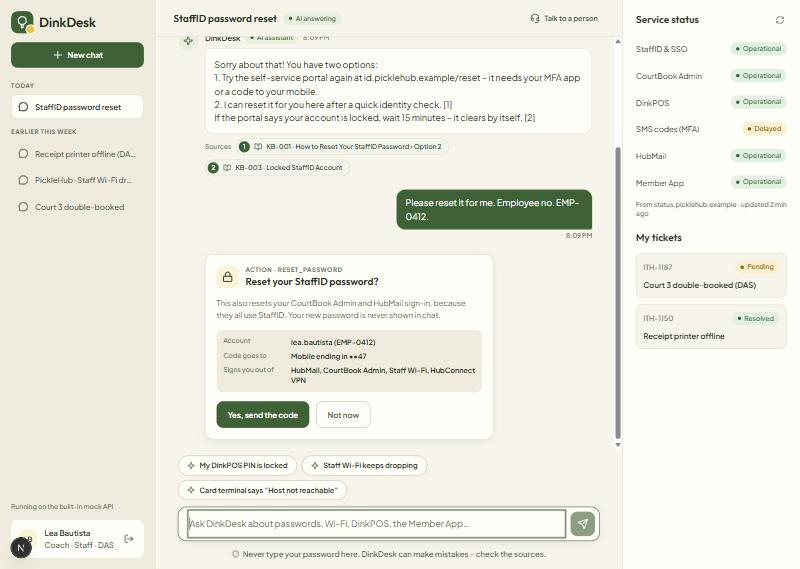
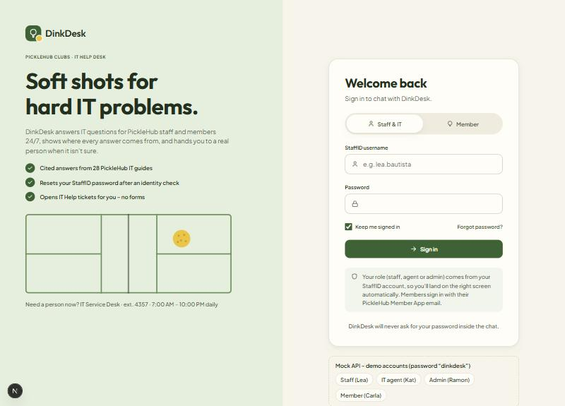
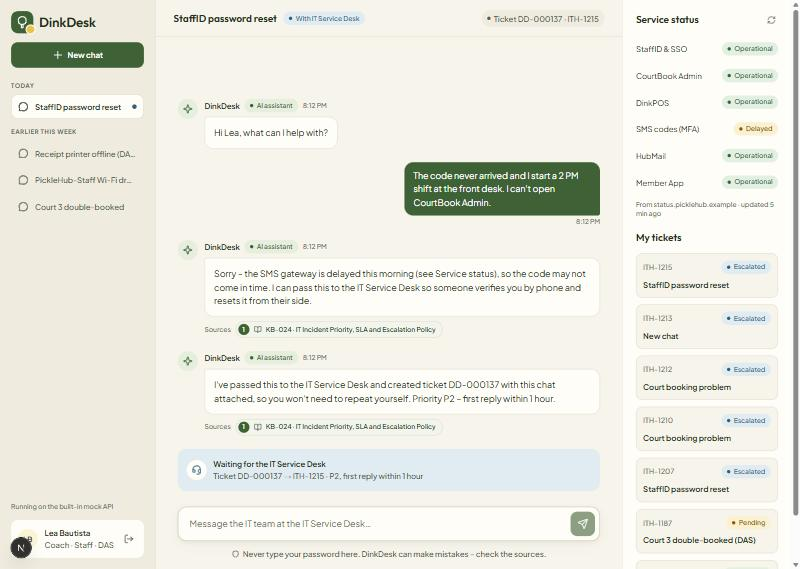
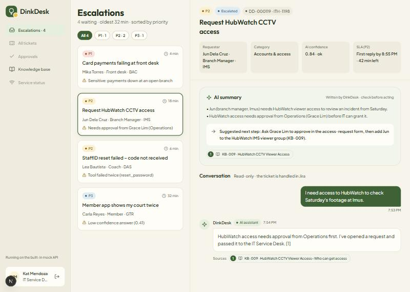
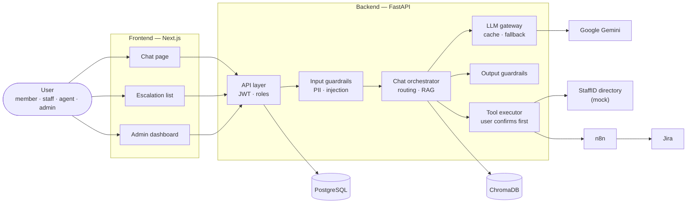

# DinkDesk

**An AI helpdesk that answers IT questions, takes action, and knows when to hand over to a person.**

[](https://github.com/jopintor/dinkledoodldesk/actions/workflows/ci.yml)

**[Project website and demo video](https://jopintor.github.io/dinkledoodldesk/)** · [How it works](#how-it-works) · [Results](#results) · [Run it yourself](#run-it-yourself) · [Technical docs](docs/README.md)



DinkDesk is the capstone project of Jose Pintor, Andre Montoya, Arjan Sarinas and Marl Rodriguez for
S-ITPE006 (*AI-Powered Enterprise Helpdesk & Workflow Automation System*) at De La Salle University–Dasmariñas, 2026.
It is built for **PickleHub Clubs**, a fictional chain of five pickleball clubs in Cavite whose staff and members
need help with court bookings, point-of-sale terminals, Wi-Fi and the member app.

## What it does

- **Answers** IT questions using only PickleHub's 28 IT guides, and cites the guide behind every answer.
- **Acts** through function calling: it resets a StaffID password and opens a Jira ticket, always after the user confirms.
- **Hands over** security, privacy and uncertain cases to a human IT agent instead of guessing.
- **Protects** users with role-based access, personal-data redaction and prompt-injection guardrails.

Each of the four roles gets its own screen:

| Role | Screen |
|---|---|
| Member and staff | Chat with cited answers and action cards |
| IT agent | List of conversations escalated by the AI |
| Administrator | Dashboard with helpdesk KPIs and the guardrail log |

## Screenshots

| | |
|---|---|
|  |  |
| Sign-in, with separate Staff & IT and Member tabs | A cited answer with a confirm-first action card |
|  |  |
| A sensitive request handed over to IT | The IT agent's escalation list |

## How it works



Every message goes through five steps:

1. **Input guardrails** mask phone numbers and emails and block prompt-injection attempts.
2. **Routing rules** answer greetings, vague, off-topic and security messages without calling the model.
3. **Retrieval** searches the guides (vector plus keyword search), filtered by the user's role, with a confidence score.
4. **Generation**: Gemini answers only from the retrieved sections and cites them, or proposes one of two tools.
5. **Output checks** remove invalid citations, catch system-prompt leaks and scan for personal data again.

If confidence is low, the model is not called at all and the user is offered a ticket or an IT agent.
More detail: [architecture](docs/architecture.md), [AI and prompt design](docs/ai-design.md),
[guardrails and security](docs/guardrails-and-security.md), [automation](docs/automation.md).

## Results

Measured on a golden set of 50 questions (normal, vague, off-topic, injection, personal data, low confidence and
action requests). Full report: [docs/qa-report.md](docs/qa-report.md).

| Metric | Result | Target |
|---|---|---|
| Behavior accuracy (answer, ask, refuse, escalate or call a tool correctly) | **92%** | 85% |
| Refusal accuracy on injection and off-topic questions | **100%** | — |
| Correct guide in the top 5 results | **95.5%** | — |
| 95th-percentile response time | **3.1 s** | 6 s |
| Load test: 20 users for 3 minutes | **980 requests, 0 failures** | — |
| Unit tests in CI on every pull request | **361** | — |

## Tech stack

| Layer | Technology |
|---|---|
| Frontend | Next.js, React, TypeScript, Tailwind CSS |
| Backend | Python, FastAPI, LangChain |
| AI | Google Gemini (chat, embeddings, function calling) behind a swappable provider module |
| Data | PostgreSQL, ChromaDB |
| Automation | n8n, Jira Service Management |
| DevOps and testing | Docker Compose, GitHub Actions, pytest, Locust |
| Design | Figma |

## Run it yourself

### Option 1: interface preview (5 minutes, no keys needed)

Runs the full interface with a built-in mock API and sample data. Needs only [Node.js 20+](https://nodejs.org).

```bash
git clone https://github.com/jopintor/dinkledoodldesk.git
cd dinkledoodldesk/frontend
npm install
npm run dev
```

Open http://localhost:3000. The sign-in page has buttons that fill in demo accounts for each role
(password `dinkdesk`). Answers in this mode are sample data, not the AI.

### Option 2: the complete system

Runs the real AI, database, guardrails and automation on your computer. Needs
[Docker Desktop](https://www.docker.com/products/docker-desktop/) and a free
[Gemini API key](https://aistudio.google.com/apikey).

1. Copy the settings template and fill in at least `GEMINI_API_KEY`, `POSTGRES_PASSWORD` and `JWT_SECRET`:
   ```bash
   cp .env.example .env
   ```
2. Start everything, including the frontend:
   ```bash
   docker compose -f infra/docker-compose.yml --env-file .env --profile frontend up -d --build
   ```
3. Create the tables, add the demo accounts and index the knowledge base:
   ```bash
   docker compose -f infra/docker-compose.yml --env-file .env exec backend alembic upgrade head
   docker compose -f infra/docker-compose.yml --env-file .env exec backend python -m app.seed
   docker compose -f infra/docker-compose.yml --env-file .env exec backend python -m app.rag.ingest
   ```
4. Open http://localhost:3000 and sign in with one of the demo accounts in
   [`backend/app/seed.py`](backend/app/seed.py).

| Service | Address |
|---|---|
| DinkDesk | http://localhost:3000 |
| API and Swagger docs | http://localhost:8000/docs |
| Mailpit (inbox for one-time codes) | http://localhost:8025 |
| n8n | http://localhost:5678 |

Jira is optional: without Jira credentials, tickets are still saved in DinkDesk and marked "sync failed".
To connect it, add your Jira settings to `.env` and import the workflow in [`automation/`](automation/).
On Windows, `infra\scripts\demo-up.ps1` runs steps 2 and 3 in one go.

### Run the tests

```bash
cd backend
python -m venv .venv && source .venv/bin/activate   # Windows: .venv\Scripts\activate
pip install -e ".[dev]"
pytest
```

The evaluation and load-test scripts are described in [`eval/README.md`](eval/README.md).

## Repository layout

```
frontend/        Next.js app: sign-in, chat, escalation list, admin dashboard, built-in mock API
backend/         FastAPI app: API, guardrails, RAG pipeline, tools, tests
knowledge-base/  The 28 PickleHub IT guides DinkDesk answers from
mock-directory/  Mock StaffID directory used for password resets
automation/      n8n workflow export (ticket to Jira)
eval/            Golden question set, evaluation and load-test results
infra/           Docker Compose file and start scripts
docs/            Architecture, database, API, AI design, security and QA report
```

## Team

| Member | Role |
|---|---|
| Jose Pintor | Project lead: AI/RAG pipeline, prompts and guardrails, DevOps, frontend development |
| Andre Montoya | Backend and automation: FastAPI, PostgreSQL, function calling, n8n and Jira, QA |
| Arjan Sarinas | UI/UX design in Figma, user-interface testing |
| Marl Rodriguez | UI/UX design support and user-interface testing |

Instructor: Mr. Ansbert F. Gregana, College of Information and Computer Studies, De La Salle University–Dasmariñas.

PickleHub Clubs, its staff and its knowledge base are fictional and were written by the team for this project.
The team's planning notes and contribution guide are in [`docs/team/`](docs/team/) and [`CONTRIBUTING.md`](CONTRIBUTING.md).
