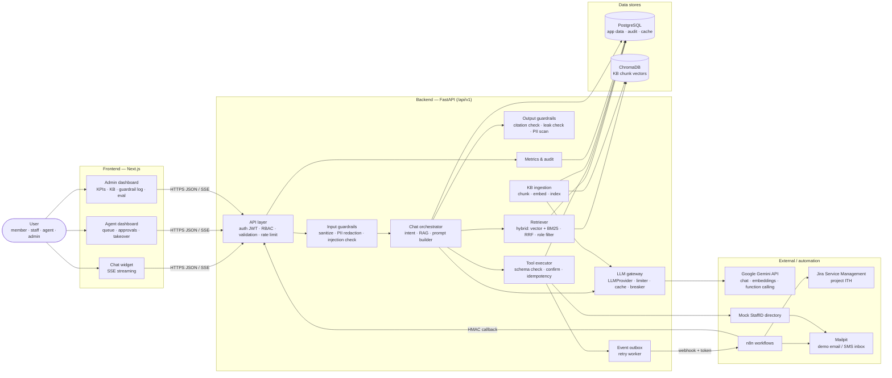
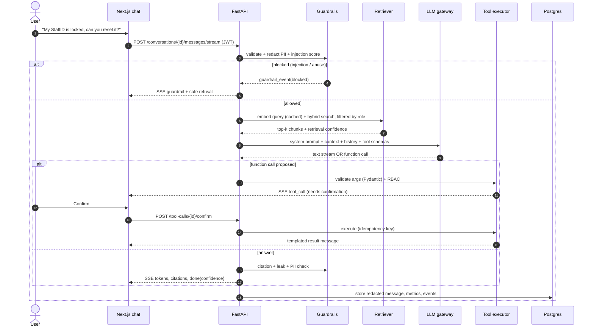
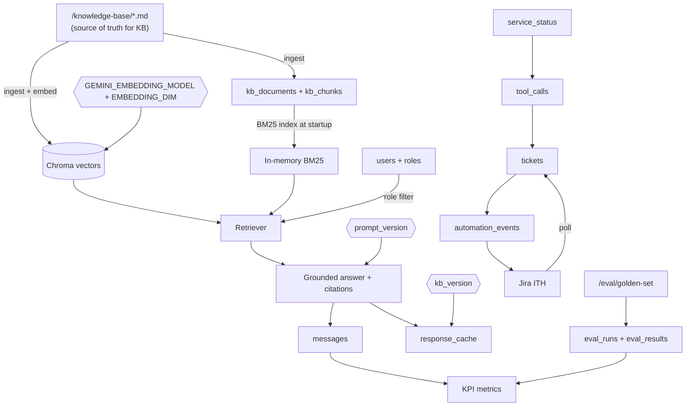
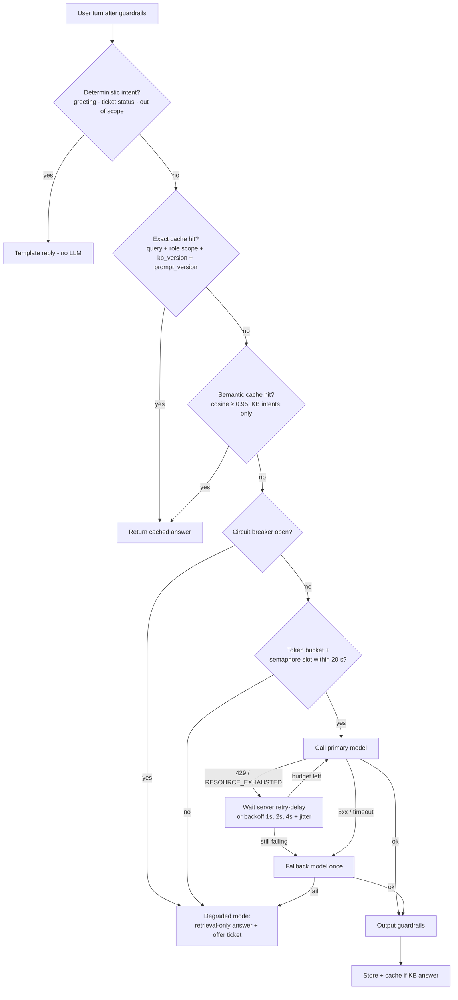
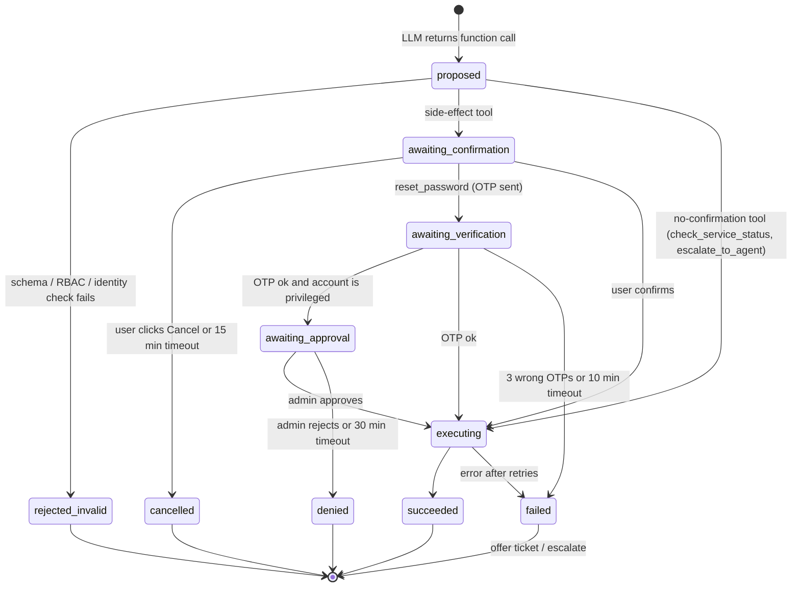
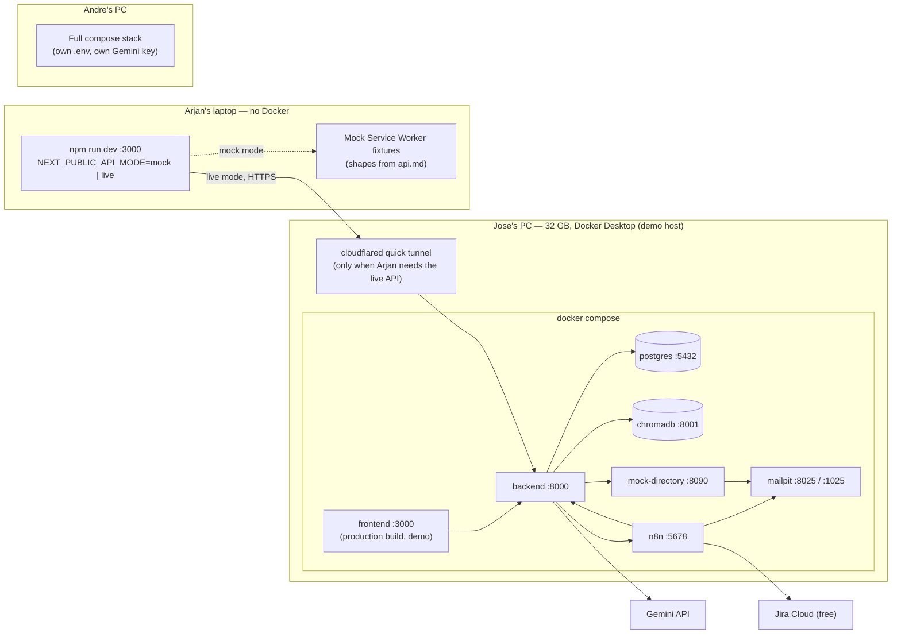

# DinkDesk — System Architecture & Component Specification

> Workstream C · owners: Jose (AI/RAG, DevOps) + Andre (backend, automation) · status: **design v1 (Sprint 0)** · last updated 2026-10-28
>
> Also serves as the Week 14 enabling assessment: system architecture diagram + component specification covering data dependencies, API rate-limiting and agent execution failures.
>
> Related: [database.md](database.md) · [api.md](api.md) · [ai-design.md](ai-design.md) · [guardrails-and-security.md](guardrails-and-security.md) · [automation.md](automation.md) · [PROJECT_PLAN.md](../PROJECT_PLAN.md)

## 1. Context

DinkDesk is the AI IT helpdesk for **PickleHub Clubs** (five fictional pickleball clubs in Cavite). It answers IT questions from a curated knowledge base with citations, performs a small set of safe actions through LLM function calling (StaffID password reset, ticket creation, service-status lookup, hand-off to a human agent), and pushes events to n8n, which talks to Jira Service Management (project `ITH`) and sends notifications.

The system names used below (StaffID, HubMail, CourtBook Admin, Member App, DinkPOS, TapPay, RallyBracket, HubWatch, HubConnect VPN, club Wi-Fi) come from the knowledge base, `KB-000`.

Design goals, in priority order:

1. **Grounded answers** — never answer an IT question without retrieved context; cite every claim; hand off to a human when confidence is low.
2. **Safe actions** — the LLM only *proposes* tool calls; the backend validates, asks the user to confirm, checks RBAC and executes. Secrets (temporary passwords, OTPs, API tokens) never pass through the LLM.
3. **Runs on the free tier** — at most one LLM generation call per user turn in the common path, aggressive caching, and graceful degradation when Gemini rate-limits.
4. **Swappable provider** — all LLM and embedding calls go through one `LLMProvider` interface.
5. **Demo-able on one PC** — the whole stack is one `docker compose up` on Jose's machine.

## 2. System architecture diagram



The same picture in the documentation template's notation:

```
[User] -> [Next.js frontend] -> [FastAPI backend] -> [Guardrails] -> [RAG + LLM gateway] -> [Gemini]
                                       |                                  |
                               [PostgreSQL]  [ChromaDB]            [Tool executor] -> [Mock directory]
                                                                          |
                                                              [Outbox] -> [n8n] -> [Jira ITH] / [Mailpit]
```

### 2.1 One chat turn, end to end



## 3. Component specification

Each component lists its responsibility, owner, the data it depends on (reads/writes), and how it fails.

| # | Component | Responsibility | Owner | Reads | Writes | Failure behaviour |
|---|---|---|---|---|---|---|
| C1 | **Next.js frontend** | Chat widget with streaming, "My tickets", agent dashboard (queue, takeover, approvals), admin dashboard (KPIs, KB, guardrail log, eval scorecard, service status) | Arjan | `/api/v1/*` | — | Shows banner on 429/503 with retry time; falls back to non-streaming endpoint if SSE breaks; mock mode for offline dev |
| C2 | **API layer** (FastAPI routers) | Auth (JWT), RBAC dependency, request validation (Pydantic), per-user rate limits, CORS, error envelope | Andre | `users`, `roles` | `audit_logs` | 401/403/422/429 with error envelope ([api.md §1](api.md#1-conventions)) |
| C3 | **Input guardrails** | Normalise text, length cap, PII detect + redact, prompt-injection scoring, scope check | Jose | regex/heuristic rules, `GUARDRAIL_*` config | `guardrail_events` | Fail **closed**: if a detector crashes, the message is treated as suspicious and only retrieval-only mode is used |
| C4 | **Chat orchestrator** | Conversation state machine, intent classification, retrieval, prompt assembly, routing to answer / tool / escalation, confidence decision | Jose | `conversations`, `messages` (last 6), intent exemplars | `messages`, `conversations` | On any downstream error → apologise, offer ticket/escalation, never a blank reply |
| C5 | **Retriever** | Query embedding, Chroma vector search + BM25 keyword search, Reciprocal Rank Fusion, role filter, confidence score | Jose | Chroma collection, `kb_chunks` (BM25 index built at startup), embedding cache | — | Chroma down → BM25-only (lower confidence); both down → escalate |
| C6 | **LLM gateway** (`LLMProvider`) | Single entry point for chat, streaming, function calling and embeddings. Rate limiter, queue, retry/backoff, model fallback, circuit breaker, response cache, token accounting | Jose | `response_cache`, quota counters | `response_cache`, `messages.tokens_*` | See §5 |
| C7 | **Output guardrails** | Every `[n]` citation maps to a supplied chunk, system-prompt canary leak check, PII scan of the answer, length/format check | Jose | prompt canary, chunk ids | `guardrail_events` | Failed check → replace answer with safe fallback + offer escalation |
| C8 | **Tool executor** | Validates function-call args, enforces role allowlist, binds identity (user can only act on self), user confirmation, OTP verification, idempotent execution, templated result text | Andre | `tool_calls`, `users`, `service_status` | `tool_calls`, `tickets`, `escalations`, `automation_events`, `audit_logs` | See §6 |
| C9 | **Event outbox + retry worker** | Writes outbound events in the same DB transaction as the business change; background task delivers them to n8n with retries | Andre | `automation_events` | `automation_events` | n8n down → events stay `pending`, retried with backoff; after 6 attempts → `dead`, visible in admin dashboard |
| C10 | **Webhook receiver** | Accepts n8n callbacks (Jira key synced, Jira status changed, notification sent), verifies HMAC + timestamp | Andre | `N8N_CALLBACK_SECRET` | `tickets`, `automation_events` | Bad signature → 401 + guardrail/audit entry; duplicate event id → 200 no-op |
| C11 | **KB ingestion** | Parse Markdown + frontmatter from `/knowledge-base`, split by heading, chunk, embed in batches, upsert to Chroma, record metadata; only changed docs (content hash) | Jose | `/knowledge-base/*.md` | `kb_documents`, `kb_chunks`, Chroma | Embedding quota hit mid-run → job paused and resumable; old chunks stay live until the new version is fully indexed |
| C12 | **Metrics & audit** | KPI aggregation (deflection, automation success, latency p50/p95, escalation rate, MTTR, CSAT), guardrail feed, eval scorecard import | Andre (API) / Jose (eval) | all tables | `audit_logs`, `eval_runs`, `eval_results` | Read-only; slow query → cached 60 s |
| C13 | **n8n** | Event-driven workflows: Jira sync, escalation notify + SLA reminder, password-reset approval, Jira status poll, daily KPI digest | Andre | webhooks from backend, Jira API | Jira issues, emails, backend callbacks | Built-in retry on Jira/SMTP nodes; error workflow posts `delivery_failed` back to backend |
| C14 | **Mock StaffID directory** | Stand-in for the real directory: look up account, send OTP, verify OTP, reset password (temp password emailed to Mailpit), unlock | Andre | its own seed file | its own store, Mailpit | Down → reset tool returns `DIRECTORY_UNAVAILABLE`, user offered a ticket |
| C15 | **PostgreSQL** | System of record ([database.md](database.md)) | Andre | — | — | Backend `/health/ready` fails; compose restarts; nightly `pg_dump` before demo |
| C16 | **ChromaDB** | Vector store for KB chunks | Jose | — | — | Rebuildable from `/knowledge-base` with `POST /kb/reindex` |
| C17 | **Mailpit** | Local SMTP sink with web UI; stands in for email and SMS in demos | Jose | — | — | Non-critical; notifications still visible in the dashboards |

### 3.1 Data dependencies

What each data asset depends on, and what breaks if it is wrong or missing.



| Data | Source of truth | Consumers | Consistency rule |
|---|---|---|---|
| KB content | Markdown in `/knowledge-base` (git) | ingestion → Chroma + `kb_chunks` | Chroma is a derived index. Changing `GEMINI_EMBEDDING_MODEL` or `EMBEDDING_DIM` creates a **new collection** and needs a full re-index; the collection name is `${CHROMA_COLLECTION}__<model>__<dim>`. |
| `kb_version` | Incremented on every successful (re)index | response cache key | Any KB change invalidates cached answers automatically. |
| `prompt_version` | Constant in `backend/app/ai/prompts.py` | cache key, `messages`, `eval_runs` | Bump on every prompt edit so metrics can be compared before/after (showcase idea #3). |
| Users and roles | Postgres (seeded demo users) | RBAC, retrieval role filter, tool identity binding | Role read from DB on each request (not trusted from the JWT alone). |
| Directory accounts | Mock directory seed | reset tool | Linked by `users.directory_username`. |
| Tickets | Postgres; Jira holds a mirror | dashboards, KPIs | Postgres is authoritative for DinkDesk KPIs; Jira status is pulled back every 5 min. |
| Service status | `service_status` table (admin-editable) | `check_service_status` tool, status widget | Admin sets a service to `partial_outage`/`major_outage` to demo incident handling. Values follow KB-025. |
| Golden test set | `/eval/golden-set` (owned by workstream B) | eval runner | Results imported into `eval_runs`/`eval_results`. |

## 4. Key design decisions

| Decision | Choice | Why |
|---|---|---|
| Orchestration style | **Single-agent, one generation call per turn**; tool results are rendered from templates, not sent back to the LLM | Halves LLM calls on the free tier, makes tool output deterministic and testable, and prevents the model from rephrasing (or leaking) tool results |
| Intent classification | **Embedding similarity to labelled exemplars** (reuses the query embedding already computed for retrieval); LLM fallback only when the margin is small | Zero extra generation calls in the common case |
| Retrieval | Hybrid (Chroma cosine + BM25) fused with RRF | IT queries mix exact tokens ("DinkPOS", "error 0x51") and paraphrases; hybrid search is also a spec requirement |
| Side effects | LLM proposes → backend validates → **user confirms** → backend executes | Defends against prompt-injection-driven actions; satisfies human-in-the-loop |
| Ticket system integration | Backend never calls Jira directly; it emits events to n8n through a transactional outbox | Jira credentials stay in n8n only; tickets exist locally even if n8n/Jira is down |
| Jira → DinkDesk updates | n8n **polls** Jira every 5 min | Avoids exposing n8n to the internet for Jira webhooks |
| Notifications | Email via Mailpit (local SMTP sink) | Free, offline, visible during the demo |
| Streaming | Server-Sent Events over `fetch` (POST) | One-way token stream is all we need; simpler than WebSockets |
| Auth | Email + password, JWT bearer (60 min), argon2 hashes | Simple for a demo; see trade-offs in [guardrails-and-security.md §4](guardrails-and-security.md#4-authentication--rbac) |

## 5. API rate limiting (Gemini free tier) and LLM failure handling

### 5.1 Planning assumptions

Gemini free-tier quotas are per project, per model, and change often. **Check the current numbers on the Gemini API rate-limits page before Sprint 1** and put them in `.env`; the code reads them from config and never hard-codes them.

Variables marked *(new)* are not yet in the root `.env.example` (workstream A) and should be added there; the others already exist with these names.

| Setting | Default (conservative) | Meaning |
|---|---|---|
| `GEMINI_CHAT_MODEL` | `gemini-2.5-flash` | primary generation model |
| `GEMINI_FALLBACK_MODEL` *(new)* | `gemini-2.5-flash-lite` | used when the primary is rate-limited or its daily quota is near the limit (separate quota bucket) |
| `GEMINI_EMBEDDING_MODEL` / `EMBEDDING_DIM` *(new)* | `models/gemini-embedding-001` / `768` | query + document embeddings |
| `LLM_RPM_LIMIT` *(new)* | `8` | our own ceiling, set a bit below the published RPM |
| `LLM_RPD_LIMIT` *(new)* | `200` | our own daily ceiling for the primary model |
| `LLM_MAX_CONCURRENCY` *(new)* | `2` | in-flight generation calls |
| `LLM_QUEUE_MAX_WAIT_S` *(new)* | `20` | longest a request may wait for a slot |
| `LLM_REQUEST_TIMEOUT_S` *(new)* | `25` | per call |

Budget per user turn: **1 embedding call** (skipped on cache hit) + **0 or 1 generation call** (0 on cache hit or deterministic intents). Extra calls only for: escalation hand-off summary (1), ambiguous-intent fallback (1), or a retry.

### 5.2 Mechanisms (in the order a request meets them)



1. **Deterministic short-cuts** — greetings, "what's the status of my ticket", clearly out-of-scope requests and guardrail refusals are answered from templates without the LLM.
2. **Response cache** (`response_cache` table) — key = SHA-256 of normalised query + role scope + `kb_version` + `prompt_version`. TTL 24 h. Only answers to KB questions with no personal data are cached; tool calls and personalised replies never are.
3. **Semantic cache** — reuses a cached answer when the new query embedding has cosine ≥ 0.95 with a cached query of the same role scope. Uses the embedding we already computed for retrieval.
4. **Embedding cache** — LRU (in-process, 2 000 entries) of query → vector.
5. **Client-side limiter** — async token bucket at `LLM_RPM_LIMIT` plus a concurrency semaphore. Requests wait in a bounded queue (max 20 waiting, max 20 s). Beyond that the user gets a degraded answer rather than an error page.
6. **Retry with backoff** — on HTTP 429 / `RESOURCE_EXHAUSTED`, honour the server's suggested retry delay if present, else exponential backoff with full jitter (base 1 s, ×2, max 3 attempts), but never past the 25 s request budget.
7. **Model fallback** — one attempt on `GEMINI_FALLBACK_MODEL` after the retries, or immediately on 5xx/timeout.
8. **Daily quota guard** — counts calls per model per day (reset at Pacific midnight, the quota day). At 90 % of `LLM_RPD_LIMIT` the gateway switches to the fallback model; at 100 % of both it serves cache + degraded mode only and shows a banner in the admin dashboard.
9. **Circuit breaker** — 5 consecutive failures opens the breaker for 60 s; one probe call then closes or re-opens it.
10. **Degraded mode** — instead of a generated answer, return the top 3 retrieved sections verbatim with their citations, plus "I couldn't write a full answer right now — here are the most relevant guides. Want me to open a ticket?" This keeps the helpdesk useful and is honest about it.
11. **Ingestion throttling** — documents are embedded in batches (≤ 100 texts per request), only for changed documents (content hash), at ≤ 50 % of the embedding RPM so live chat is not starved.
12. **Demo protection** — `scripts/warm_cache.py` pre-runs the demo script questions so they are served from cache on defense day; a backup demo video covers total outage (showcase idea #4).

Our own API also rate-limits callers (see [api.md §1.5](api.md#15-rate-limits)): 20 chat messages/min per user, 5 login attempts/min per IP.

### 5.3 LLM error taxonomy

| Error | Detection | Handling | User sees |
|---|---|---|---|
| Rate limited (429) | status / `RESOURCE_EXHAUSTED` | backoff → fallback → degraded | answer (maybe slower) or degraded answer |
| Daily quota exhausted | quota guard / 429 with daily quota detail | fallback model → cache-only | degraded answer + banner for admins |
| Timeout / 5xx | exception, `LLM_REQUEST_TIMEOUT_S` | fallback once → degraded | degraded answer |
| Safety block (Gemini refuses) | finish reason `SAFETY` | log `guardrail_events` (stage `output`), no retry | polite refusal + offer agent |
| Malformed function call | args fail Pydantic validation | one repair attempt is **not** made (quota); tool call marked `failed` | "I need a bit more detail: …" (asks for the missing field) |
| Unknown tool name | not in allowlist | rejected, logged as possible injection | safe fallback |
| Empty / uncited answer for a KB intent | output guardrail | treat as low confidence | "I'm not sure" + offer ticket/escalation |
| Stream breaks mid-answer | SSE disconnect | message stored as `partial`; client may retry the non-streaming endpoint | "Connection dropped — retry" |

## 6. Agent execution failures (tool calls)

Tool calls move through a state machine stored in `tool_calls.status`.



| Failure | Where | Handling | Retry? | User-visible result |
|---|---|---|---|---|
| Invalid / missing arguments | validation | ask a targeted follow-up question for the missing field | user re-asks | "Which system is affected — CourtBook Admin or DinkPOS?" |
| Role not allowed (e.g. member asks for StaffID reset) | RBAC allowlist | `rejected_invalid`, `guardrail_events(rbac_denied)` | no | explanation + correct path (KB link) |
| Identity mismatch (asks to reset someone else's account) | identity binding | rejected; the tool ignores any username argument from the LLM | no | "I can only reset your own account" (matches KB-001) |
| Duplicate execution (double click, client retry) | `idempotency_key` unique | second call returns the first result | n/a | same result once |
| Mock directory down / timeout | HTTP to `mock-directory` | 2 retries (0.5 s, 1 s) then `failed` | auto | "Reset service is unavailable — I've opened ticket DD-000123" (auto-ticket) |
| Wrong OTP ×3 | directory verify | `failed`, account flagged, escalation created (`reason=verification_failed`) | no | told to contact Service Desk (KB-001 option 3) |
| Approval timeout / rejection | n8n + approvals | `denied`; user notified | no | "Your reset needs an IT Lead approval and was not approved — an agent will contact you" |
| n8n / Jira unavailable | outbox delivery | ticket is saved locally (`jira_sync_status=pending`); outbox retries 1, 2, 4, 8, 16, 32 min; then `dead` | auto | ticket number `DD-…` shown immediately; Jira key appears later |
| Tool succeeded but response lost | executor | result stored before reply; client re-fetches conversation | n/a | no duplicate action |
| Unexpected exception | executor | `failed`, stack trace to logs only (no PII), error id returned | no | apology + error id + offer escalation |

Every tool execution writes an `audit_logs` row (actor, tool, target, outcome) regardless of outcome.

## 7. Deployment view



| Node | Runs | Notes |
|---|---|---|
| Jose's PC | Everything via `docker compose up` (infra files from workstream A) | Demo host. Postgres data and n8n's own SQLite data in named volumes; `pg_dump` + n8n workflow export before the defense. |
| Arjan's laptop | Only the Next.js dev server | `NEXT_PUBLIC_API_MODE=mock` uses Mock Service Worker fixtures that follow [api.md](api.md); `live` points `NEXT_PUBLIC_API_BASE_URL` at the tunnel URL. Backend `CORS_ORIGINS` must include the tunnel's origin and `http://localhost:3000`. |
| Andre's PC | Full stack for backend/n8n development | Uses his own Gemini API key so the team's quotas don't collide. |
| Cloudflare quick tunnel | `cloudflared tunnel --url http://localhost:8000` on Jose's PC | Exposes **only** the backend, only while needed; the URL changes each run. n8n, Postgres, Chroma, Mailpit and the mock directory are never exposed. |
| GitHub Actions | lint + unit tests (FakeProvider, no Gemini key needed) | Integration tests that hit Gemini run locally only. |

Resource estimate on the host: Postgres ~300 MB, Chroma ~300 MB, n8n ~400 MB, backend ~500 MB (BM25 index + models are remote), mock directory + Mailpit < 100 MB, frontend ~300 MB → under 2.5 GB RAM.

## 8. Provider swap

```python
class LLMProvider(Protocol):
    async def generate(
        self,
        messages: list[ChatMessage],
        tools: list[ToolSpec] | None = None,
        *,
        temperature: float = 0.2,
        max_output_tokens: int = 800,
    ) -> LLMResult: ...
    def stream(
        self, messages: list[ChatMessage], tools: list[ToolSpec] | None = None, **kwargs
    ) -> AsyncIterator[LLMChunk]: ...
    async def embed(
        self, texts: list[str], *, task: Literal["query", "document"]
    ) -> list[list[float]]: ...
```

Implementations: `GeminiProvider` (LangChain `ChatGoogleGenerativeAI` + `GoogleGenerativeAIEmbeddings`), `FakeProvider` (deterministic, for tests/CI and Arjan-free demos), and optionally `OpenAIProvider`. Selected by `LLM_PROVIDER`. The rate limiter, cache and breaker wrap the provider, so they work for any implementation. Swapping the **embedding** model requires a re-index (new Chroma collection); swapping only the chat model does not.
