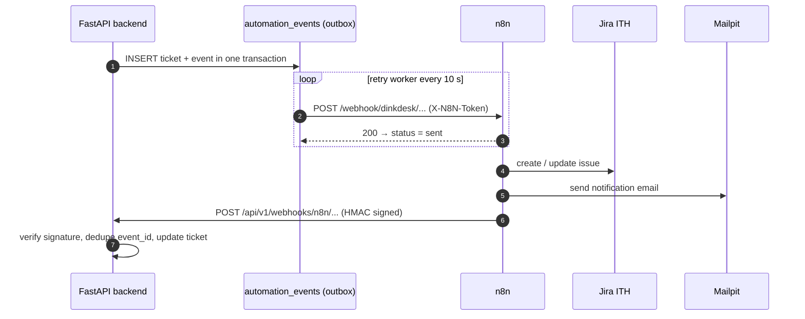
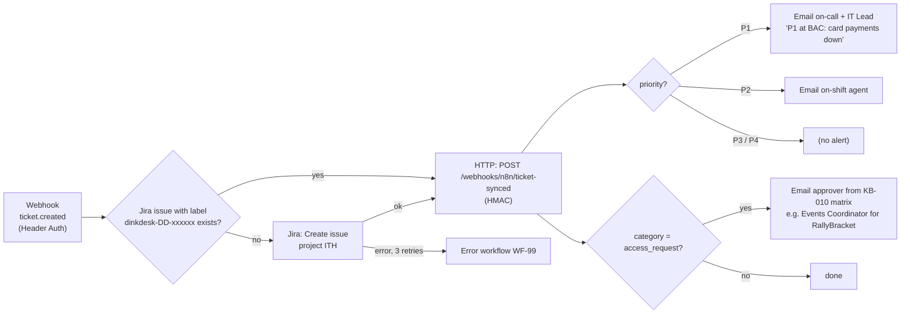
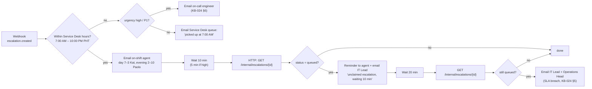
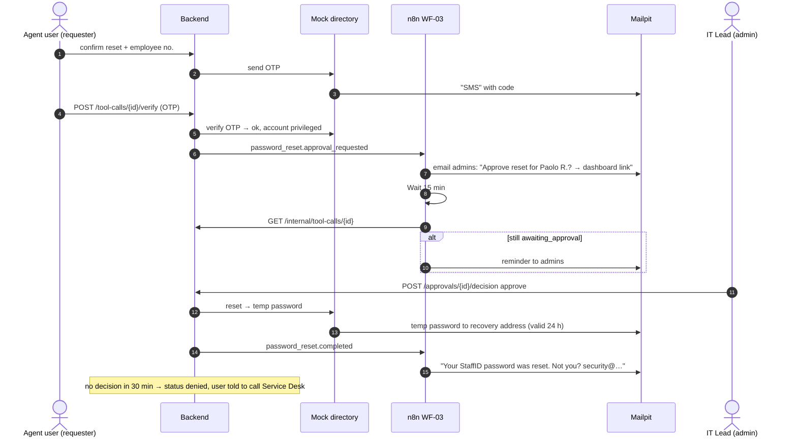
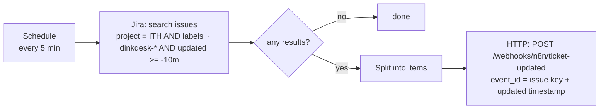

# DinkDesk — Workflow Automation (n8n)

> Workstream C · owner: Andre (n8n, Jira) · status: **design v1** · last updated 2026-10-28
>
> Documentation template §10 format: **[User Request] → [AI] → [Decision] → [Action/Notification]**. Workflow exports will live in `/automation/n8n/*.json`.
>
> Related: [architecture.md](architecture.md) · [api.md §10](api.md#10-webhooks-and-internal-endpoints-n8n) · [guardrails-and-security.md §5](guardrails-and-security.md#5-secret-handling)

## 1. How DinkDesk and n8n talk



Rules every workflow follows:

- **Backend owns the data, n8n owns the integrations.** n8n never writes to Postgres directly; it calls back through signed webhooks. Jira credentials exist only in n8n.
- **Event envelope** (backend → n8n):
  ```json
  {
    "event_id": "0192f2a1-…",
    "event_type": "ticket.created",
    "occurred_at": "2026-11-05T02:31:00Z",
    "correlation_id": "<ticket / escalation / tool_call id>",
    "data": { "…": "event-specific, already PII-redacted" }
  }
  ```
- **Delivery:** at-least-once. The outbox retries after 1, 2, 4, 8, 16, 32 min, then marks the event `dead` (visible in the admin dashboard with a "retry" button). n8n workflows are idempotent on `event_id` (they check Jira for a `dinkdesk-<ticket_number>` label before creating).
- **Callbacks:** signed with HMAC-SHA256 (n8n `Crypto` node) — headers `X-DinkDesk-Timestamp` and `X-DinkDesk-Signature`.
- **Errors:** every workflow sets the shared **Error Workflow** (WF-99), which posts to `/webhooks/n8n/delivery-failed`.
- **Email:** the n8n `Send Email` node uses SMTP `mailpit:1025`. All recipients are fictional `@picklehub.example` addresses; Mailpit catches everything so the demo shows the emails at `http://localhost:8025`.

## 2. Workflow catalogue

| ID | Name | Trigger | Main actions | Spec requirement covered |
|---|---|---|---|---|
| WF-01 | Ticket → Jira | webhook `ticket.created` | create Jira issue, call back with key, P1/P2 alert, access-request approver notice | automated ticket logging |
| WF-01b | Ticket update → Jira | webhook `ticket.updated` | transition Jira issue / add comment | ticket sync |
| WF-02 | Escalation notify + SLA reminder | webhook `escalation.created` | email on-shift agent, wait, re-check, remind / escalate to IT Lead | human escalation |
| WF-03 | Password-reset approval | webhook `password_reset.approval_requested` | email IT Lead with dashboard link, wait, remind, expire | password-reset workflow |
| WF-03b | Password-reset confirmation | webhook `password_reset.completed` | email user "your password was reset — not you? report it" | password-reset workflow |
| WF-04 | Jira status poll | schedule, every 5 min | JQL search for changed `ITH` issues → backend callback | two-way sync without exposing n8n |
| WF-05 | Daily KPI digest (optional) | schedule, 8:00 AM PHT | `GET /internal/metrics/daily` → email IT Lead | KPI reporting |
| WF-99 | Error handler | n8n Error Trigger | callback `delivery-failed` + email admin | resilience |

## 3. WF-01 — Ticket creation → Jira

**[User Request]** "Court 3 shows two bookings at 6 PM in CourtBook, please log it." → **[AI]** intent `member_app_booking`, RAG answer from KB-020, model calls `create_ticket` → user confirms the card → **[Decision]** backend validates, checks for an existing incident (KB-025), saves ticket `DD-000125`, emits `ticket.created` → **[Action/Notification]** n8n creates `ITH-58`, calls back, alerts if P1/P2, notifies the approver for access requests.



`ticket.created` payload (`data`):

```json
{
  "ticket_id": "0192f2…", "ticket_number": "DD-000125",
  "summary": "CourtBook shows Court 3 double-booked at 6 PM (Imus)",
  "description": "Front desk at Imus sees two bookings for Court 3 at 6:00 PM today. Followed KB-020 front-desk steps; duplicate still shown.",
  "category": "member_app_booking", "affected_system": "courtbook", "priority": "P3", "club_code": "IMS",
  "requester": { "display_name": "Mika R.", "role": "staff", "email": "mika.reyes@picklehub.example" },
  "source": "ai_tool", "conversation_url": "http://localhost:3000/agent/conversations/0192f1d0-…"
}
```

Jira field mapping:

| DinkDesk | Jira (ITH) |
|---|---|
| `summary` | Summary, prefixed `[DD-000125]` |
| `description` + conversation link | Description |
| `priority` P1/P2/P3/P4 | Priority Highest/High/Medium/Low |
| `category`, `affected_system`, `club_code` | Labels `cat-…`, `sys-…`, `branch-…`, plus `dinkdesk-DD-000125` |
| requester | Reporter stays the integration user; requester name/email in description (free tier has no customer accounts for fictional users) |

Approver routing for `access_request` (from KB-010): RallyBracket → Events Coordinator; HubConnect VPN, CourtBook Branch Manager/Head Office → Operations Head; HubWatch → branch manager + Operations Head (DPO cc); DinkPOS Cashier / CourtBook Front Desk → branch manager; local admin rights, DinkDesk agent/admin role → IT Lead. The email asks the approver to reply on the Jira issue; DinkDesk itself never grants access (KB-026).

## 4. WF-02 — Escalation notification and SLA reminder

**[User Request]** "Let me talk to a person" / security incident / low-confidence answer → **[AI]** `escalate_to_agent` (or a backend rule) + hand-off summary (prompt P7) → **[Decision]** backend creates escalation + linked ticket, picks urgency, emits `escalation.created` → **[Action/Notification]** n8n emails the agent on shift, waits, and escalates up the chain if nobody claims it.



`escalation.created` payload (`data`):

```json
{
  "escalation_id": "e1", "ticket_number": "DD-000124", "reason": "low_confidence", "urgency": "normal",
  "priority": "P3", "club_code": "IMS",
  "handoff_summary": "Imus front-desk staff cannot open CourtBook Admin since this morning…",
  "dashboard_url": "http://localhost:3000/agent/escalations/e1"
}
```

The notification contains only the summary and a dashboard link — no transcript — so personal context stays inside DinkDesk behind login.

## 5. WF-03 — Password-reset approval (privileged accounts)

Normal staff resets complete inside DinkDesk after the OTP (no approval). Accounts with agent/admin rights need the IT Lead's approval, because KB-010 makes the IT Lead the approver for those roles.

**[User Request]** "Reset my StaffID password" (from an agent/admin account) → **[AI]** model calls `reset_password` → user confirms, enters employee number and OTP → **[Decision]** backend sees the directory account is privileged → tool call `awaiting_approval`, emits `password_reset.approval_requested` → **[Action/Notification]** n8n emails the approvers; an admin approves in the dashboard; backend performs the reset via the mock directory; n8n confirms to the user (WF-03b).



Design notes:

- The approval link opens the DinkDesk dashboard (login required). We deliberately do **not** use n8n "approve via link" resume URLs: a link in an email would let anyone who sees the email approve a privileged reset.
- An admin cannot approve their own reset (`SELF_APPROVAL`), so the demo seeds two admin accounts.
- The temporary password goes from the mock directory straight to Mailpit. It never passes through n8n, the backend's database, the LLM or the chat.

`password_reset.approval_requested` payload (`data`):

```json
{ "tool_call_id": "t9", "requester": { "display_name": "Paolo R.", "role": "agent" }, "system": "staffid",
  "reason": "forgot_password", "otp_verified": true, "expires_at": "2026-11-05T03:15:00Z",
  "approval_url": "http://localhost:3000/admin/approvals/t9" }
```

## 6. WF-04 — Jira status poll

**[User Request]** (none — scheduled) → **[AI]** none → **[Decision]** has an `ITH` issue with a `dinkdesk-*` label changed in the last 10 minutes? → **[Action/Notification]** POST `/webhooks/n8n/ticket-updated`; the backend updates the ticket and DinkDesk emails/notifies the requester ("Your ticket DD-000125 is now Resolved").



The 10-minute window overlaps the 5-minute schedule on purpose; duplicates are dropped by `event_id`. Polling means Jira never needs to reach n8n, so n8n is never exposed to the internet.

## 7. WF-05 (optional) and WF-99

- **WF-05 Daily KPI digest:** Schedule 8:00 AM PHT → `GET /api/v1/internal/metrics/daily` (HMAC-signed like the other internal reads; returns the same shape as `/metrics/summary` for yesterday) → HTML email to the IT Lead with deflection rate, escalations, automation success, p95 latency, open P1/P2 tickets.
- **WF-99 Error handler:** n8n Error Trigger → `POST /webhooks/n8n/delivery-failed` with workflow name, failing node and correlation id → email the admin. The backend marks the related outbox event `failed` and the ticket `jira_sync_status = failed`, which shows a "retry sync" button in the agent dashboard.

## 8. Testing the workflows

| Test | How | Expected |
|---|---|---|
| Ticket sync happy path | create ticket via chat | `ITH-*` issue exists with labels; ticket shows `jira_key` within ~10 s |
| n8n down | `docker compose stop n8n`, create ticket, restart | ticket `DD-*` shown immediately; event retried; Jira key appears after restart |
| Jira auth failure | wrong token in n8n credential | WF-99 fires; ticket `jira_sync_status = failed`; admin email in Mailpit |
| Duplicate delivery | replay the same `ticket.created` | one Jira issue only |
| Forged callback | POST `ticket-updated` with bad signature | `401`, `audit_logs` `webhook.rejected` |
| Escalation SLA | create escalation, don't claim | reminder after 10 min (set to 1 min in test mode via `SLA_TEST_MODE`) |
| Privileged reset | agent requests reset, admin approves | temp-password email + confirmation email in Mailpit; `audit_logs` has approval |
| Approval timeout | don't decide | tool call `denied` after 30 min (1 min in test mode); user informed |

Workflow exports (`/automation/n8n/WF-01-ticket-to-jira.json`, …) are committed without credentials; credentials are recreated from `.env` values when the stack is set up (documented in the README).
