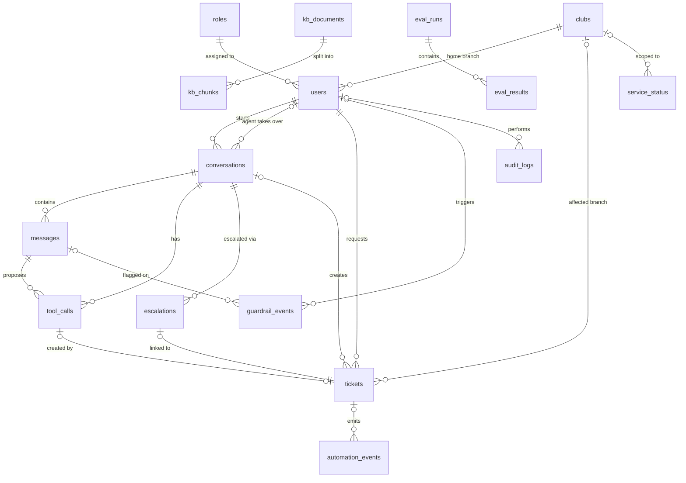
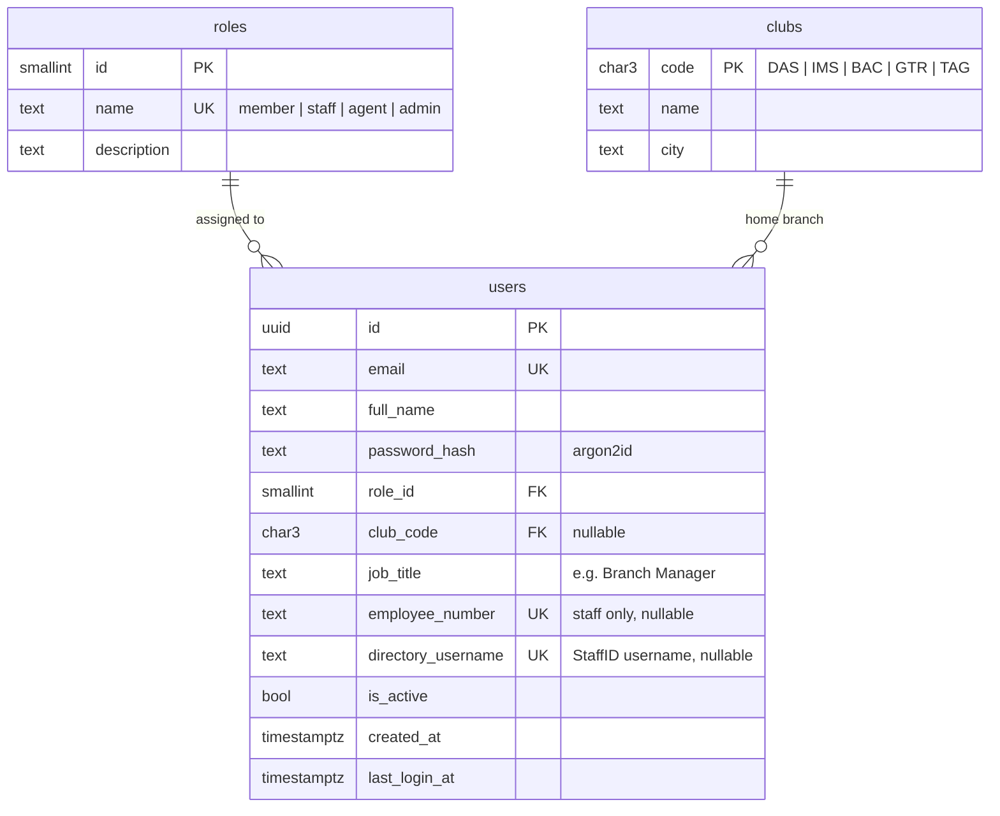
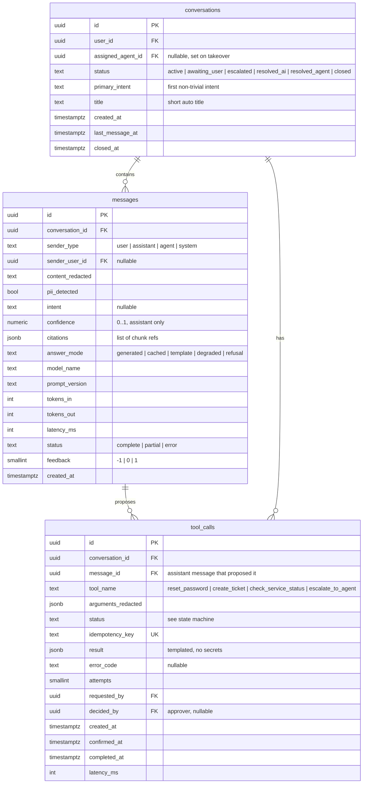
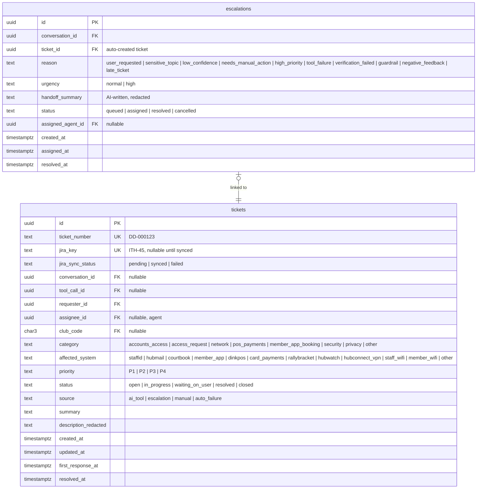
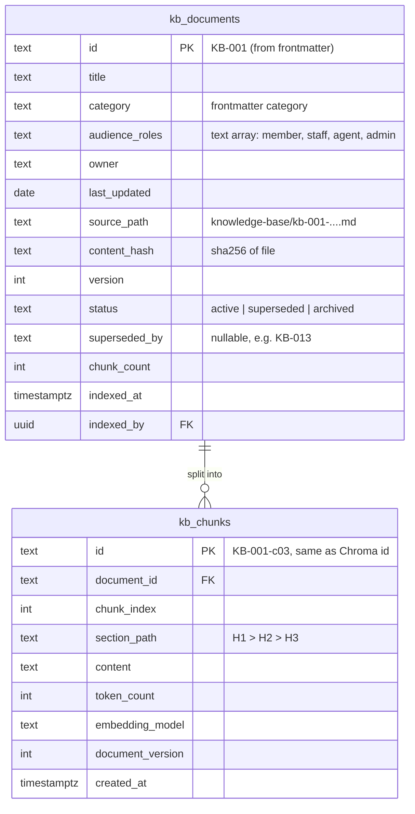

# DinkDesk — Database Design (ERD)

> Workstream C · owner: Andre (schema, migrations) with Jose (KB, eval tables) · status: **design v1** · last updated 2026-10-28
>
> Related: [architecture.md](architecture.md) · [api.md](api.md) · [ai-design.md](ai-design.md)

PostgreSQL 16 is the system of record. ChromaDB holds only the embedding vectors of KB chunks; every chunk's text and metadata also lives in Postgres (`kb_chunks`), so Chroma can be rebuilt at any time.

Conventions:

- Primary keys are `uuid` (generated in the app, `uuid7` for time-ordering) unless noted.
- All timestamps are `timestamptz` stored in UTC; the UI shows Philippine Time (UTC+8).
- Enumerations are Postgres `text` columns with a `CHECK` constraint (easier to migrate than native enums). Allowed values are listed below.
- Migrations: Alembic, in `/backend/alembic`. Seed data (roles, clubs, demo users, service list) in `/backend/app/seed.py`.
- **Privacy by design:** message text, tool arguments and ticket descriptions are stored **after PII redaction**. Raw user input is never written to the database or logs. See [guardrails-and-security.md §1](guardrails-and-security.md#1-pii-redaction).

## 1. Overview (relationships only)

Supporting tables `response_cache` and `automation_events` are described in §6.

## 2. Users, roles, branches

| Entity | Purpose |
|---|---|
| **roles** | The four RBAC roles. Permissions per role are defined in code (`permissions.py`) and documented in the [RBAC matrix](guardrails-and-security.md#42-rbac-matrix); the table exists so users reference a role by FK and the admin UI can list them. |
| **clubs** | The five PickleHub branches from `KB-000`. Used to route tickets and scope service-status incidents. |
| **users** | Everyone who signs in to DinkDesk. `directory_username` links a staff user to their (mock) StaffID account; members have none, which is how the reset tool knows members cannot use it. `job_title` lets prompts and RBAC recognise branch managers (VPN/CCTV guides). |

## 3. Conversations and AI activity

| Entity | Purpose |
|---|---|
| **conversations** | One chat thread. `status` drives the chat UI and KPIs: `resolved_ai` = deflected (no ticket, no escalation, user confirmed "this solved it" or closed after a positive answer); `escalated` = in the agent queue; `resolved_agent` = a human finished it. |
| **messages** | Every turn, including agent replies during a takeover. Assistant messages carry the observability fields used by the KPI dashboard and the Week 15 QA report: `confidence`, `citations` (e.g. `[{"n":1,"chunk_id":"…","doc_id":"KB-001","section":"Option 2: Ask DinkDesk to reset it"}]`), `answer_mode`, `model_name`, `prompt_version`, token counts and `latency_ms`. `feedback` is the thumbs up/down. |
| **tool_calls** | Every function call the LLM proposed, whether or not it ran. `status` follows the state machine in [architecture.md §6](architecture.md#6-agent-execution-failures-tool-calls): `proposed, rejected_invalid, awaiting_confirmation, awaiting_verification, awaiting_approval, executing, succeeded, failed, cancelled, denied`. `idempotency_key` (= hash of conversation id + proposing message id + tool name) prevents double execution. Automation success rate = `succeeded / (succeeded + failed)`. OTP codes and temporary passwords are **never** stored here. |

## 4. Tickets and escalations

| Entity | Purpose |
|---|---|
| **tickets** | DinkDesk's own ticket record. Postgres is authoritative for KPIs; Jira (`ITH` project) is a mirror created by n8n. `ticket_number` is shown to the user immediately, `jira_key` arrives later via callback. Priorities P1–P4 follow the definitions in the knowledge base (`KB-024`). MTTR = `avg(resolved_at − created_at)`. |
| **escalations** | A hand-off to a human agent. Every escalation also creates a ticket (`source = escalation`) so nothing is lost if the agent cannot resolve it live. `handoff_summary` is the AI-written summary the agent sees first (prompt in [ai-design.md §8](ai-design.md#8-prompt-design-table)). Time to first agent response = `assigned_at − created_at`. |

## 5. Knowledge base

| Entity | Purpose |
|---|---|
| **kb_documents** | One row per Markdown file in `/knowledge-base`. Fields mirror the file's frontmatter (`id`, `title`, `category`, `audience_roles`, `last_updated`, `owner`). `content_hash` lets re-index skip unchanged files. Documents with frontmatter `status: superseded` (today only KB-014, replaced by KB-013) are indexed with `is_current = false` so retrieval can down-rank and label them ([ai-design.md §3](ai-design.md#3-retrieval)). Archiving a document removes its vectors from Chroma but keeps the row for audit. |
| **kb_chunks** | One retrievable section. `id` is deterministic (`<doc id>-c<two-digit index>`, e.g. `KB-001-c03`) and identical to the Chroma record id, so a citation can always be resolved back to text. `content` feeds the BM25 index and the citation preview in the UI. Chroma stores the vector plus metadata `doc_id`, `title`, `section_path`, `category`, `is_current`, and the role flags `role_member`, `role_staff`, `role_agent`, `role_admin` used for filtering. |

The global `kb_version` (an integer in a one-row `app_settings` table) is incremented after every successful (re)index and is part of the response-cache key.

## 6. Governance, evaluation and plumbing

```mermaid
erDiagram
    guardrail_events {
        uuid id PK
        uuid user_id FK "nullable"
        uuid conversation_id FK "nullable"
        uuid message_id FK "nullable"
        text stage "input | retrieval | output | tool | auth"
        text type "pii_redacted | prompt_injection | jailbreak | system_prompt_leak | invalid_citation | off_topic | abuse | rbac_denied | rate_limited | invalid_signature | llm_safety_block"
        text action "allowed_redacted | blocked | escalated | flagged"
        text detector "regex | heuristic | canary | llm | rbac"
        numeric score
        jsonb details "matched rule ids, entity types, never the raw value"
        timestamptz created_at
    }
    audit_logs {
        bigint id PK
        uuid actor_id FK "nullable for system / n8n"
        text actor_type "user | system | n8n"
        text action "e.g. tool.reset_password.executed"
        text entity_type
        text entity_id
        text outcome "success | failure | denied"
        inet ip_address
        jsonb details
        timestamptz created_at
    }
    eval_runs {
        uuid id PK
        text label "e.g. prompt-v3-hybrid"
        text dataset_version
        text prompt_version
        text model_name
        text git_sha
        int n_questions
        jsonb metrics "faithfulness, answer_relevance, context_precision, behavior_accuracy, refusal_accuracy, p50_ms, p95_ms"
        text notes
        timestamptz started_at
        timestamptz finished_at
    }
    eval_results {
        uuid id PK
        uuid run_id FK
        text question_id "golden-set id"
        text user_role
        text category "normal | ambiguous | unsupported | malicious_prompt_injection | pii | low_confidence | action_request"
        text expected_behavior "answer | clarify | refuse | escalate | call_tool:<name>"
        text actual_behavior
        text predicted_intent "logged, not graded in golden-v1"
        jsonb expected_source_ids
        jsonb retrieved_doc_ids
        jsonb scores
        bool passed
        int latency_ms
    }
    service_status {
        uuid id PK
        text service_key "courtbook | member_app | dinkpos | card_payments | ..."
        char3 club_code FK "nullable = all branches"
        text display_name
        text status "operational | degraded_performance | partial_outage | major_outage | maintenance"
        text message "incident note incl. workaround"
        uuid updated_by FK
        timestamptz updated_at
    }
    automation_events {
        uuid id PK
        text event_type "ticket.created | escalation.created | password_reset.approval_requested | password_reset.completed | ..."
        text direction "outbound | inbound"
        text correlation_id "ticket / escalation / tool_call id"
        jsonb payload "redacted"
        text status "pending | sent | failed | dead | received"
        smallint attempts
        timestamptz next_attempt_at
        text last_error
        timestamptz created_at
    }
    response_cache {
        text cache_key PK "sha256"
        text role_scope
        int kb_version
        text prompt_version
        text normalized_query
        jsonb answer "text + citations + confidence"
        int hit_count
        timestamptz created_at
        timestamptz expires_at
    }
    eval_runs ||--o{ eval_results : contains
```

| Entity | Purpose |
|---|---|
| **guardrail_events** | Every time a guardrail fires: PII redacted, injection blocked, RBAC denial, rate limit, bad webhook signature, LLM safety block. Feeds the live **Guardrail Log** panel for the "Try to break DinkDesk" demo segment. `details` holds rule ids and entity *types* (e.g. `["PH_MOBILE","EMAIL"]`), never the matched value. |
| **audit_logs** | Append-only record of security-relevant actions: sign-ins, tool executions, approvals, ticket changes, KB uploads/re-index, role changes, service-status changes. The application DB role has `INSERT`/`SELECT` only on this table. |
| **eval_runs / eval_results** | Results of running the golden test set (`/eval/golden-set/golden_set.jsonl`, 50 items, fields `id, question, user_role, category, expected_source_ids, expected_behavior, reference_answer`) against a given prompt version and model. Powers the evaluation scorecard and the before/after prompt-iteration chart. |
| **service_status** | Current health of each PickleHub system — the data behind `status.picklehub.example` (`KB-025`). One row per service, or per service *and* branch for Wi-Fi (`UNIQUE(service_key, club_code)`). Service keys follow KB-025: `courtbook, member_app, dinkpos, card_payments, hubmail, staff_wifi, member_wifi, hubconnect_vpn, hubwatch, rallybracket, dinkdesk`. Status values and colours also follow KB-025. Read by the `check_service_status` tool and by the duplicate-incident check in `create_ticket`; edited by admins to stage an incident during the demo. |
| **automation_events** | Transactional outbox for events sent to n8n (written in the same transaction as the ticket/escalation) and a log of inbound n8n callbacks (dedupe by event id). The retry worker reads `pending` rows whose `next_attempt_at` has passed. |
| **response_cache** | Cached answers to KB questions, keyed by normalised query + role scope + `kb_version` + `prompt_version`. Used to stay inside the Gemini free-tier quota (see [architecture.md §5](architecture.md#5-api-rate-limiting-gemini-free-tier-and-llm-failure-handling)). |

## 7. Indexes and retention

| Table | Indexes (besides PK/UK) | Retention |
|---|---|---|
| messages | `(conversation_id, created_at)`, `(created_at)` for KPIs | 180 days, then purge (demo: keep) |
| conversations | `(user_id, last_message_at desc)`, `(status)` | 180 days |
| tool_calls | `(conversation_id)`, `(status, created_at)` | 1 year |
| tickets | `(requester_id)`, `(status, priority)`, `(jira_key)` | indefinite |
| escalations | `(status, created_at)` | indefinite |
| guardrail_events | `(created_at desc)`, `(type)` | 1 year |
| audit_logs | `(created_at desc)`, `(actor_id)`, `(entity_type, entity_id)` | 1 year minimum |
| automation_events | `(status, next_attempt_at)` | 30 days after `sent` |
| response_cache | `(expires_at)` | expired rows deleted hourly |

## 8. KPI definitions (computed from these tables)

| KPI | Formula | Tables |
|---|---|---|
| Ticket deflection rate | conversations with `status = resolved_ai` ÷ conversations with ≥ 1 user message (period) | conversations |
| Escalation rate | conversations with ≥ 1 escalation ÷ conversations | escalations, conversations |
| Automation success rate | `succeeded ÷ (succeeded + failed)` tool calls | tool_calls |
| Answer latency p50 / p95 | percentile of `messages.latency_ms` for assistant messages | messages |
| Cache hit rate | assistant messages with `answer_mode = cached` ÷ assistant messages | messages |
| MTTR | `avg(resolved_at − created_at)` of resolved tickets | tickets |
| CSAT proxy | thumbs-up ÷ (thumbs-up + thumbs-down) | messages |
| Guardrail blocks | count by `type` | guardrail_events |
| RAG quality | faithfulness, answer relevance, context precision from the latest eval run | eval_runs |
